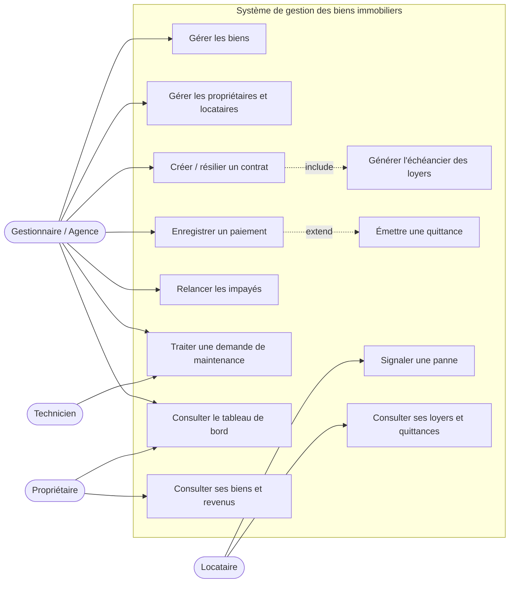
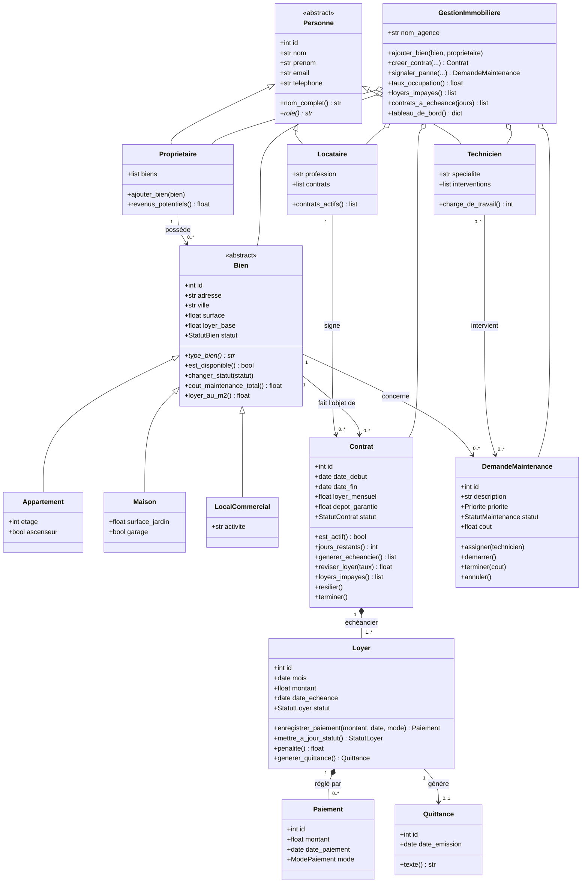

# Gestion des biens immobiliers (POO – Python)

Mini-projet de conception et programmation orientée objet : suivi des locations, contrats, loyers et maintenance.

## 1. Diagramme de cas d'utilisation général



## 2. Diagramme de classes



Les mêmes diagrammes sont fournis en PlantUML : `diagramme_classes.puml` et `cas_utilisation.puml`.

## 3. Structure du code

| Fichier | Contenu |
|---|---|
| `enums.py` | Statuts, priorités, modes de paiement |
| `personnes.py` | `Personne` (abstraite), `Proprietaire`, `Locataire`, `Technicien` |
| `biens.py` | `Bien` (abstraite), `Appartement`, `Maison`, `LocalCommercial` |
| `contrat.py` | `Contrat` (échéancier, révision, résiliation) |
| `finances.py` | `Loyer`, `Paiement`, `Quittance` |
| `maintenance.py` | `DemandeMaintenance` |
| `gestion.py` | `GestionImmobiliere` (façade + statistiques) |
| `main.py` | Démonstration |
| `test_immobilier.py` | Tests unitaires |

Concepts POO utilisés : encapsulation, héritage (`Personne`, `Bien`), classes abstraites, polymorphisme (`role()`, `type_bien()`), composition (`Contrat` → `Loyer` → `Paiement`) et agrégation (`GestionImmobiliere`).

## 4. Exécution

```bash
python main.py
python -m unittest -v
```
